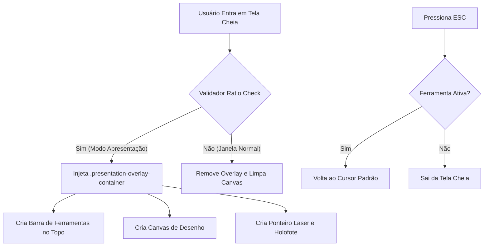

# Implementação de Ponteiros Especiais e Ferramentas de Apresentação em Tela Cheia

Este guia detalha a arquitetura, estilos e lógica de script necessários para implementar um painel flutuante de ferramentas de foco (Ponteiro Laser, Holofote, Caneta Marca-Texto e Cursor de Navegação) compatível com qualquer navegador moderno, independente do nível de zoom ou do número de monitores.

---

## 1. Arquitetura da Solução

A funcionalidade é composta por três camadas principais:
1. **Script (`laser-pointer.js`):** Gerencia a detecção de tela cheia (com cálculo de proporções de aspecto resiliente a zoom), injeta a interface do painel dinamicamente, processa eventos de mouse/toque e renderiza traços no elemento `<canvas>`.
2. **Estilização (`style.css`):** Posiciona a barra flutuante de ferramentas no topo com visual moderno (*glassmorphism*), define o estilo do ponteiro laser pulsante e aplica a máscara escura com gradiente radial para o holofote.
3. **Páginas de Destino (HTML):** Importam o arquivo JavaScript imediatamente antes do fechamento da tag `</body>` para ativação global do sistema.



---

## 2. Folha de Estilos (CSS)

Adicione as seguintes classes CSS à folha de estilos global do seu projeto. Essas regras implementam o visual moderno e dão suporte às classes de controle dinâmico inseridas pelo JavaScript.

```css
/* ==========================================================================
   SISTEMA DE APRESENTAÇÃO - PONTEIRO LASER, HOLOFOTE E CANETA MARCA-TEXTO
   ========================================================================== */

/* Container Geral de Sobreposição */
.presentation-overlay-container {
  position: fixed;
  top: 0;
  left: 0;
  width: 100vw;
  height: 100vh;
  z-index: 999999;
  pointer-events: none; /* Deixa cliques passarem para a página por padrão */
  font-family: system-ui, -apple-system, sans-serif;
  user-select: none;
}

/* Ocultar cursor padrão do navegador ao usar ferramentas especiais */
.presentation-cursor-hidden,
.presentation-cursor-hidden * {
  cursor: none !important;
}

/* Ocultar componentes normais do site (ex: navbar) em apresentação */
.presentation-active .nav-bar {
  display: none !important;
}

/* Elemento do Ponteiro Laser */
.presentation-laser-dot {
  position: absolute;
  width: 24px;
  height: 24px;
  border-radius: 50%;
  pointer-events: none;
  transform: translate(-50%, -50%);
  z-index: 20;
  opacity: 0;
  transition: opacity 0.15s ease-out;
  background: radial-gradient(circle, #ffffff 15%, var(--laser-color, #dc2626) 55%, transparent 70%);
  box-shadow: 0 0 10px 2px var(--laser-color, #dc2626), 
              0 0 20px 5px var(--laser-color, #dc2626);
}

/* Aura Pulsante do Laser */
.presentation-laser-dot::after {
  content: '';
  position: absolute;
  top: -8px;
  left: -8px;
  right: -8px;
  bottom: -8px;
  border-radius: 50%;
  background: var(--laser-color, #dc2626);
  opacity: 0.15;
  animation: laserPulse 1.5s infinite ease-out;
}

@keyframes laserPulse {
  0% { transform: scale(0.6); opacity: 0.35; }
  100% { transform: scale(1.4); opacity: 0; }
}

/* Máscara do Holofote (Spotlight) */
.presentation-spotlight-mask {
  position: absolute;
  top: 0;
  left: 0;
  width: 100%;
  height: 100%;
  z-index: 5;
  pointer-events: none;
  opacity: 0;
  transition: opacity 0.3s ease-in-out;
  background: radial-gradient(
    circle var(--spotlight-radius, 240px) at var(--spotlight-x, 0px) var(--spotlight-y, 0px),
    transparent 98%,
    rgba(0, 0, 0, 0.75) 100%
  );
}

.presentation-spotlight-mask.active {
  opacity: 1;
}

/* Canvas da Caneta Marca-Texto */
.presentation-highlighter-canvas {
  position: absolute;
  top: 0;
  left: 0;
  width: 100%;
  height: 100%;
  z-index: 10;
  pointer-events: auto; /* Permite capturar eventos de desenho */
  display: none;
}

/* Barra de Ferramentas Flutuante */
.presentation-toolbar {
  position: absolute;
  top: 24px;
  left: 50%;
  transform: translateX(-50%) translateY(0);
  z-index: 30;
  pointer-events: auto; /* Reativa cliques para os botões */
  display: flex;
  align-items: center;
  gap: 16px;
  padding: 10px 20px;
  background: rgba(255, 255, 255, 0.75);
  backdrop-filter: blur(20px) saturate(180%);
  -webkit-backdrop-filter: blur(20px) saturate(180%);
  border: 1px solid rgba(226, 226, 226, 0.6);
  border-radius: 12px;
  box-shadow: 0 10px 30px rgba(0, 0, 0, 0.12);
  transition: opacity 0.3s cubic-bezier(0.4, 0, 0.2, 1), 
              transform 0.3s cubic-bezier(0.4, 0, 0.2, 1);
}

.presentation-toolbar.hidden {
  opacity: 0;
  transform: translateX(-50%) translateY(-40px);
  pointer-events: none;
}

/* Botões da Barra de Ferramentas */
.presentation-btn {
  background: transparent;
  border: none;
  width: 38px;
  height: 38px;
  display: flex;
  align-items: center;
  justify-content: center;
  color: #1a1a1a;
  border-radius: 8px;
  cursor: pointer;
  transition: all 0.2s ease;
  position: relative;
}

.presentation-btn:hover {
  background: rgba(0, 0, 0, 0.06);
  color: #000;
}

.presentation-btn.active {
  background: #000;
  color: #fff;
}

/* Tooltip das Ferramentas (Exibido Abaixo) */
.presentation-btn::after {
  content: attr(data-tooltip);
  position: absolute;
  top: 48px;
  left: 50%;
  transform: translateX(-50%) translateY(-5px);
  background: rgba(0, 0, 0, 0.85);
  color: #fff;
  font-size: 11px;
  font-weight: 500;
  padding: 5px 8px;
  border-radius: 4px;
  white-space: nowrap;
  opacity: 0;
  pointer-events: none;
  transition: all 0.15s ease-out;
  box-shadow: 0 4px 8px rgba(0,0,0,0.1);
}

.presentation-btn:hover::after {
  opacity: 1;
  transform: translateX(-50%) translateY(0);
}

/* Divisor Interno */
.presentation-divider {
  width: 1px;
  height: 24px;
  background: rgba(0, 0, 0, 0.12);
}

/* Círculos de Seleção de Cor */
.color-swatch {
  width: 20px;
  height: 20px;
  border-radius: 50%;
  cursor: pointer;
  border: 2px solid transparent;
  transition: transform 0.2s ease;
  position: relative;
}

.color-swatch:hover {
  transform: scale(1.15);
}

.color-swatch.active {
  border-color: #000;
  transform: scale(1.1);
}

.color-swatch.red { background-color: #dc2626; }
.color-swatch.green { background-color: #059669; }
.color-swatch.blue { background-color: #2563eb; }
.color-swatch.yellow { background-color: #d97706; }
```

---

## 3. Lógica do Script (JavaScript)

Crie o arquivo `/js/laser-pointer.js` com o seguinte código modular. Ele cuida do ciclo de vida da apresentação, detectando redimensionamentos de tela cheia e eventos interativos.

```javascript
// laser-pointer.js - Ferramentas de Apresentação Interativa para Projetos Web
(function () {
  let isPresentationActive = false;
  let activeTool = 'cursor'; // cursor, laser, spotlight, highlighter
  let activeColor = 'red'; // red, green, blue, yellow
  let toolbarHideTimeout = null;
  let isDrawing = false;
  let isToolbarHovered = false;

  const COLOR_MAP = {
    red: '#dc2626',
    green: '#059669',
    blue: '#2563eb',
    yellow: '#d97706'
  };

  let overlayContainer = null;
  let laserDot = null;
  let spotlightMask = null;
  let highlighterCanvas = null;
  let canvasCtx = null;
  let toolbar = null;

  // 1. Escutas do Teclado (F11 e Atalhos)
  document.addEventListener('keydown', (e) => {
    // F11 Nativo ou Atalho Alt + F11
    if (e.key === 'F11' || (e.altKey && e.key === 'F11')) {
      e.preventDefault();
      togglePresentationMode();
    }

    // Tecla Escape (ESC) - Intercepta para resetar ferramenta antes de sair do modo tela cheia
    if (e.key === 'Escape' && isPresentationActive) {
      if (activeTool !== 'cursor') {
        selectTool('cursor');
        e.preventDefault();
        e.stopPropagation();
      }
    }
  });

  // 2. Detecção de Tela Cheia (Zoom e Monitor-Independent)
  function checkIsFullscreen() {
    if (document.fullscreenElement) return true;

    // Comparação de Proporções: em tela cheia (sem abas ou URL), 
    // a razão da janela externa e interna horizontal coincide com a vertical.
    if (window.outerWidth && window.outerHeight && window.innerWidth && window.innerHeight) {
      const widthRatio = window.outerWidth / window.innerWidth;
      const heightRatio = window.outerHeight / window.innerHeight;
      const ratioDiff = Math.abs(widthRatio - heightRatio);
      
      // Limiar tolerante de 0.08 para acomodar barras de rolagem
      if (ratioDiff < 0.08) return true;
    }

    // Fallback: Comparação de dimensões externas com a resolução do monitor
    if (window.screen) {
      const isOuterMatch = Math.abs(window.outerWidth - window.screen.width) <= 20 && 
                           Math.abs(window.outerHeight - window.screen.height) <= 20;
      if (isOuterMatch) return true;
      
      const isInnerMatch = Math.abs(window.innerWidth - window.screen.width) <= 20 && 
                           Math.abs(window.innerHeight - window.screen.height) <= 20;
      if (isInnerMatch) return true;
    }

    return false;
  }

  function handleScreenChange() {
    const isFullscreen = checkIsFullscreen();

    if (isFullscreen) {
      if (!isPresentationActive) {
        enterPresentationLayout();
      } else {
        resizeCanvas();
      }
    } else {
      if (isPresentationActive) {
        exitPresentationLayout();
      }
    }
  }

  document.addEventListener('fullscreenchange', handleScreenChange);
  window.addEventListener('resize', handleScreenChange);

  function togglePresentationMode() {
    const isFullscreen = checkIsFullscreen();
    if (!isFullscreen) {
      document.documentElement.requestFullscreen().catch(() => {
        enterPresentationLayout(); // Fallback caso o navegador bloqueie a API nativa
      });
    } else {
      if (document.fullscreenElement) {
        document.exitFullscreen();
      } else {
        exitPresentationLayout();
      }
    }
  }

  // 3. Montagem do Layout
  function enterPresentationLayout() {
    isPresentationActive = true;
    activeTool = 'cursor';
    activeColor = 'red';
    
    document.body.classList.add('presentation-active');

    overlayContainer = document.querySelector('.presentation-overlay-container');
    if (!overlayContainer) {
      overlayContainer = document.createElement('div');
      overlayContainer.className = 'presentation-overlay-container';
      document.body.appendChild(overlayContainer);
    }
    overlayContainer.innerHTML = ''; 

    // Máscara do Holofote
    spotlightMask = document.createElement('div');
    spotlightMask.className = 'presentation-spotlight-mask';
    overlayContainer.appendChild(spotlightMask);

    // Canvas da Caneta
    highlighterCanvas = document.createElement('canvas');
    highlighterCanvas.className = 'presentation-highlighter-canvas';
    overlayContainer.appendChild(highlighterCanvas);
    canvasCtx = highlighterCanvas.getContext('2d');
    resizeCanvas();

    // Laser
    laserDot = document.createElement('div');
    laserDot.className = 'presentation-laser-dot';
    updateLaserColor();
    overlayContainer.appendChild(laserDot);

    createToolbar();
    setupInteractions();
    resetToolbarTimeout();
    selectTool('cursor');
  }

  function exitPresentationLayout() {
    isPresentationActive = false;
    document.body.classList.remove('presentation-active');
    document.body.classList.remove('presentation-cursor-hidden');

    if (overlayContainer) {
      overlayContainer.remove();
      overlayContainer = null;
    }
    if (toolbarHideTimeout) {
      clearTimeout(toolbarHideTimeout);
    }
  }

  // 4. Redimensionamento de Canvas sem Perda de Traço
  function resizeCanvas() {
    if (!highlighterCanvas) return;
    
    const tempCanvas = document.createElement('canvas');
    tempCanvas.width = highlighterCanvas.width;
    tempCanvas.height = highlighterCanvas.height;
    const tempCtx = tempCanvas.getContext('2d');
    
    if (highlighterCanvas.width > 0 && highlighterCanvas.height > 0) {
      tempCtx.drawImage(highlighterCanvas, 0, 0);
    }

    highlighterCanvas.width = window.innerWidth;
    highlighterCanvas.height = window.innerHeight;

    if (canvasCtx) {
      canvasCtx.lineCap = 'round';
      canvasCtx.lineJoin = 'round';
      canvasCtx.lineWidth = 4;
      canvasCtx.strokeStyle = COLOR_MAP[activeColor];
      if (tempCanvas.width > 0 && tempCanvas.height > 0) {
        canvasCtx.drawImage(tempCanvas, 0, 0);
      }
    }
  }

  // 5. Barra de Ferramentas HTML
  function createToolbar() {
    toolbar = document.createElement('div');
    toolbar.className = 'presentation-toolbar';
    
    toolbar.innerHTML = `
      <button class="presentation-btn active" data-tool="cursor" data-tooltip="Cursor Padrão (Seta)">
        <svg width="20" height="20" viewBox="0 0 24 24" fill="none" stroke="currentColor" stroke-width="2"><path d="M3 3l7.07 16.97 2.51-7.39 7.39-2.51L3 3z"/></svg>
      </button>
      <button class="presentation-btn" data-tool="laser" data-tooltip="Ponteiro Laser">
        <svg width="20" height="20" viewBox="0 0 24 24" fill="none" stroke="currentColor" stroke-width="2"><circle cx="12" cy="12" r="10"/><circle cx="12" cy="12" r="3" fill="currentColor"/></svg>
      </button>
      <button class="presentation-btn" data-tool="spotlight" data-tooltip="Focar Holofote">
        <svg width="20" height="20" viewBox="0 0 24 24" fill="none" stroke="currentColor" stroke-width="2"><circle cx="12" cy="12" r="10"/><path d="M12 2a15.3 15.3 0 0 1 4 10 15.3 15.3 0 0 1-4 10 15.3 15.3 0 0 1-4-10 15.3 15.3 0 0 1 4-10z"/></svg>
      </button>
      <button class="presentation-btn" data-tool="highlighter" data-tooltip="Caneta Marca-Texto">
        <svg width="20" height="20" viewBox="0 0 24 24" fill="none" stroke="currentColor" stroke-width="2"><path d="M12 20h9"/><path d="M16.5 3.5a2.12 2.12 0 0 1 3 3L7 19l-4 1 1-4Z"/></svg>
      </button>
      
      <div class="presentation-divider"></div>
      
      <div class="color-swatch red active" data-color="red" data-tooltip="Cor Vermelha"></div>
      <div class="color-swatch green" data-color="green" data-tooltip="Cor Verde"></div>
      <div class="color-swatch blue" data-color="blue" data-tooltip="Cor Azul"></div>
      <div class="color-swatch yellow" data-color="yellow" data-tooltip="Cor Amarela"></div>
      
      <div class="presentation-divider"></div>
      
      <button class="presentation-btn" id="btn-clear-drawings" data-tooltip="Limpar Anotações">
        <svg width="20" height="20" viewBox="0 0 24 24" fill="none" stroke="currentColor" stroke-width="2"><path d="M3 6h18"/><path d="M19 6v14c0 1-1 2-2 2H7c-1 0-2-1-2-2V6"/></svg>
      </button>
      <button class="presentation-btn" id="btn-exit-presentation" data-tooltip="Sair do Modo Apresentação">
        <svg width="20" height="20" viewBox="0 0 24 24" fill="none" stroke="currentColor" stroke-width="2"><path d="M18 13v6a2 2 0 0 1-2 2H5a2 2 0 0 1-2-2V8a2 2 0 0 1 2-2h6"/><polyline points="15 3 21 3 21 9"/><line x1="10" y1="14" x2="21" y2="3"/></svg>
      </button>
    `;

    overlayContainer.appendChild(toolbar);

    // Eventos dos botões da barra
    toolbar.querySelectorAll('[data-tool]').forEach(btn => {
      btn.addEventListener('click', () => selectTool(btn.getAttribute('data-tool')));
    });

    toolbar.querySelectorAll('[data-color]').forEach(swatch => {
      swatch.addEventListener('click', () => selectColor(swatch.getAttribute('data-color')));
    });

    toolbar.querySelector('#btn-clear-drawings').addEventListener('click', clearDrawings);
    toolbar.querySelector('#btn-exit-presentation').addEventListener('click', togglePresentationMode);

    toolbar.addEventListener('mouseenter', () => { isToolbarHovered = true; resetToolbarTimeout(); });
    toolbar.addEventListener('mouseleave', () => { isToolbarHovered = false; resetToolbarTimeout(); });
  }

  // 6. Controle das Ferramentas
  function selectTool(tool) {
    activeTool = tool;
    
    // Atualizar UI dos botões
    toolbar.querySelectorAll('[data-tool]').forEach(btn => {
      btn.classList.toggle('active', btn.getAttribute('data-tool') === tool);
    });

    // Reset de estados
    document.body.classList.toggle('presentation-cursor-hidden', tool !== 'cursor');
    if (laserDot) laserDot.style.opacity = (tool === 'laser') ? '1' : '0';
    if (spotlightMask) spotlightMask.classList.toggle('active', tool === 'spotlight');
    if (highlighterCanvas) highlighterCanvas.style.display = (tool === 'highlighter') ? 'block' : 'none';

    resetToolbarTimeout();
  }

  function selectColor(color) {
    activeColor = color;
    toolbar.querySelectorAll('[data-color]').forEach(swatch => {
      swatch.classList.toggle('active', swatch.getAttribute('data-color') === color);
    });

    updateLaserColor();
    if (canvasCtx) canvasCtx.strokeStyle = COLOR_MAP[color];
    resetToolbarTimeout();
  }

  function updateLaserColor() {
    if (laserDot) laserDot.style.setProperty('--laser-color', COLOR_MAP[activeColor]);
  }

  function clearDrawings() {
    if (canvasCtx && highlighterCanvas) {
      canvasCtx.clearRect(0, 0, highlighterCanvas.width, highlighterCanvas.height);
    }
  }

  // 7. Eventos de Movimento do Mouse e Desenho
  function setupInteractions() {
    document.addEventListener('mousemove', handlePointerMove);
    document.addEventListener('touchmove', handlePointerMove, { passive: false });

    if (highlighterCanvas) {
      highlighterCanvas.addEventListener('mousedown', startDrawing);
      highlighterCanvas.addEventListener('mousemove', draw);
      highlighterCanvas.addEventListener('mouseup', stopDrawing);
      highlighterCanvas.addEventListener('mouseleave', stopDrawing);

      highlighterCanvas.addEventListener('touchstart', startDrawing, { passive: true });
      highlighterCanvas.addEventListener('touchmove', draw, { passive: true });
      highlighterCanvas.addEventListener('touchend', stopDrawing);
    }
  }

  function handlePointerMove(e) {
    if (!isPresentationActive) return;
    resetToolbarTimeout();

    const clientX = e.touches ? e.touches[0].clientX : e.clientX;
    const clientY = e.touches ? e.touches[0].clientY : e.clientY;

    if (laserDot && activeTool === 'laser') {
      laserDot.style.left = `${clientX}px`;
      laserDot.style.top = `${clientY}px`;
    }

    if (spotlightMask && activeTool === 'spotlight') {
      spotlightMask.style.setProperty('--spotlight-x', `${clientX}px`);
      spotlightMask.style.setProperty('--spotlight-y', `${clientY}px`);
    }
  }

  function startDrawing(e) {
    if (activeTool !== 'highlighter' || !canvasCtx) return;
    isDrawing = true;
    
    const clientX = e.touches ? e.touches[0].clientX : e.clientX;
    const clientY = e.touches ? e.touches[0].clientY : e.clientY;
    
    canvasCtx.beginPath();
    canvasCtx.moveTo(clientX, clientY);
  }

  function draw(e) {
    if (!isDrawing || activeTool !== 'highlighter' || !canvasCtx) return;
    
    const clientX = e.touches ? e.touches[0].clientX : e.clientX;
    const clientY = e.touches ? e.touches[0].clientY : e.clientY;
    
    canvasCtx.lineTo(clientX, clientY);
    canvasCtx.stroke();
  }

  function stopDrawing() {
    isDrawing = false;
    resetToolbarTimeout();
  }

  // 8. Ocultação Automática da Barra
  function resetToolbarTimeout() {
    if (toolbarHideTimeout) clearTimeout(toolbarHideTimeout);
    if (isToolbarHovered || isDrawing) return;

    toolbarHideTimeout = setTimeout(() => {
      if (toolbar && activeTool !== 'cursor') {
        toolbar.classList.add('hidden');
      }
    }, 2500);

    if (toolbar) toolbar.classList.remove('hidden');
  }
})();
```

---

## 4. Injeção nas Páginas HTML

Basta adicionar a chamada de script no final da tag `<body>` das páginas que deseja oferecer o suporte:

```html
<!DOCTYPE html>
<html lang="pt-BR">
<head>
  <!-- Outros cabeçalhos -->
  <link rel="stylesheet" href="/css/style.css">
</head>
<body>

  <!-- Conteúdo de slides ou tópicos do seu site -->

  <!-- Script global e scripts de apresentação -->
  <script src="/js/laser-pointer.js"></script>
</body>
</html>
```

---

## 5. Práticas Recomendadas

1. **Aceleração por Hardware:** O holofote e o laser utilizam propriedades CSS customizadas e transições de opacidade padrão que acionam a aceleração gráfica por GPU no navegador, mantendo a performance de exibição a 60fps mesmo em telas de resolução 4K.
2. **Prevenção de Perda de Traços:** A rotina do evento `resize` clona e restaura o canvas temporariamente para que o professor não perca os desenhos e anotações explicativas no momento em que alterar as resoluções físicas ou de zoom.
3. **Escapes Suaves:** A tecla `Escape` atua de forma empilhada para maximizar a ergonomia de usabilidade durante apresentações, permitindo o cancelamento rápido de traçados ou focos sem forçar o fechamento imediato da aula em tela cheia.
